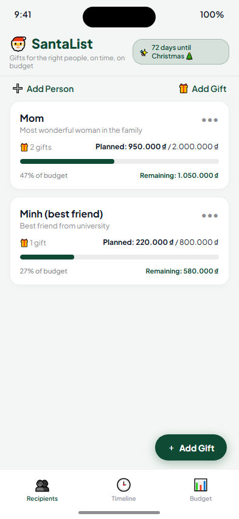
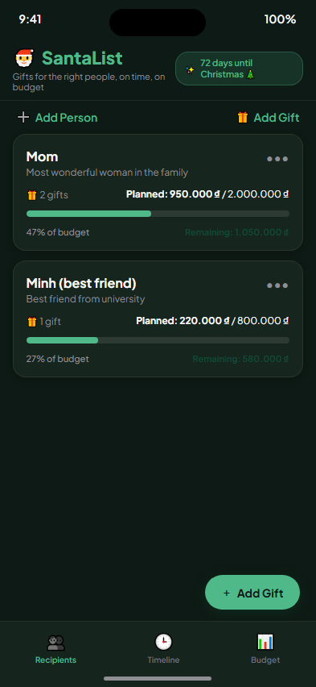
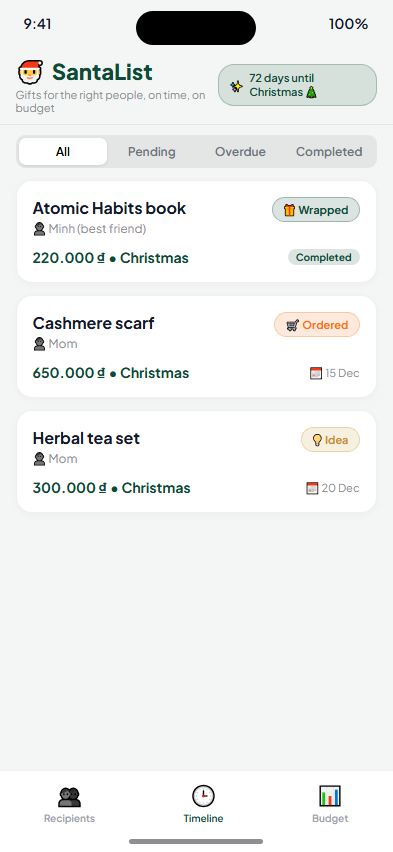
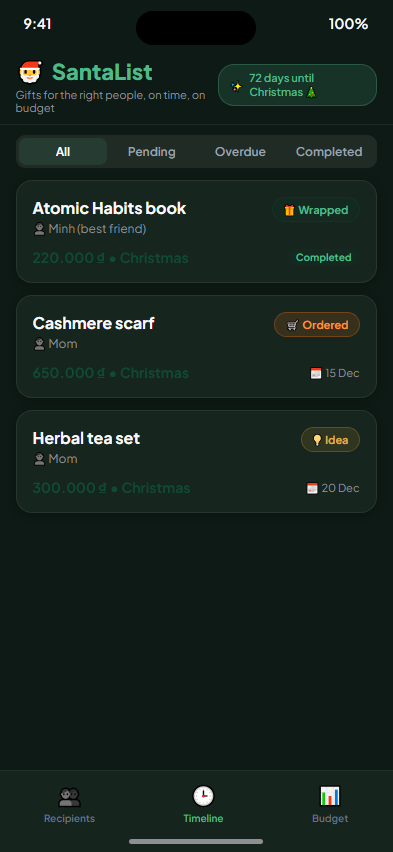
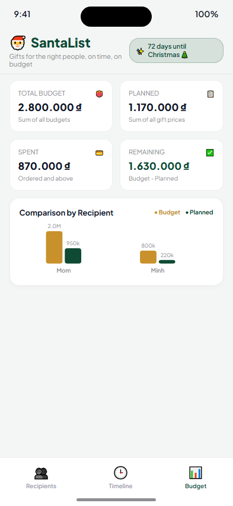
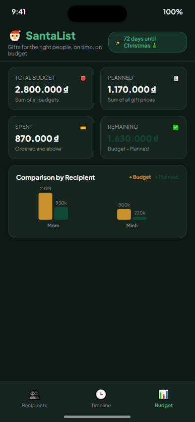
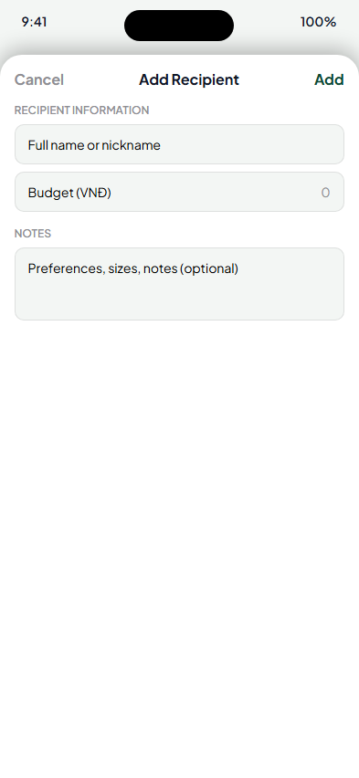
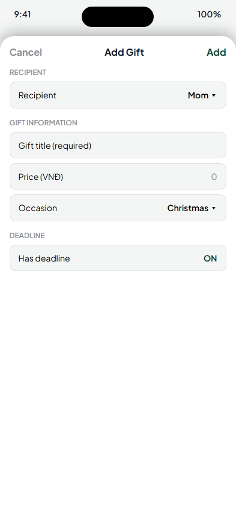
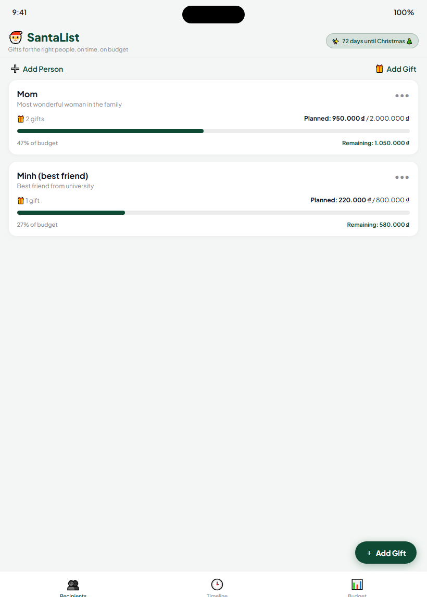

# 🎅 SantaList: Gift Tracker (iOS Native)

> **"Gifts for the right people, on time, on budget"**

A pure **iOS Native (Swift 5.9+ & SwiftUI)** gift tracking application designed for Christmas and festive occasions. Engineered with 100% offline-first storage using **SwiftData**, interactive charts with **Swift Charts**, and intelligent local reminders via **UserNotifications**.

Built strictly with zero third-party dependencies (no CocoaPods, no SPM packages beyond Apple SDKs). Maximum privacy with zero network calls, no tracking, and fully compliant with Apple's `PrivacyInfo.xcprivacy`.

---

## 📸 App Screenshots

| View | Light Appearance | Dark Appearance |
| :--- | :---: | :---: |
| **Tab 1: Recipients**<br>Recipients list, budget progress bars, gift counts |  |  |
| **Tab 2: Timeline**<br>Sorted deadlines, overdue alerts, status badges |  |  |
| **Tab 3: Budget**<br>KPI metrics & per-person Swift Charts |  |  |
| **Modal Sheets**<br>Recipient and gift forms with real-time validation |  |  |
| **iPad Layout**<br>Adaptive layout for larger screens | <div colspan="2"></div> | |

---

## ✨ 10 Core Features (100% Parity with Reference)

1. **Recipient Management**: Add, edit, and delete recipients (Name, Budget in VNĐ, Notes). Deleting a person triggers an explicit confirmation dialog and executes **Cascade Delete** across all associated gifts via SwiftData `@Relationship(deleteRule: .cascade)`.
2. **Gift Management**: Each gift belongs to a recipient, supporting title, price (VNĐ), optional due date (DatePicker with remove deadline button), occasion (Christmas, Birthday, Anniversary, Other), notes, and store URL.
3. **Interactive Status Chips**:
   - **Tap**: Cycles to next status: `Idea` ➔ `Ordered` ➔ `Received` ➔ `Wrapped` ➔ `Idea`.
   - **Long Press (Context Menu)**: Directly select any status.
   - **Swipe**: Swipe gift row to delete (with confirmation alert) or edit.
4. **Smart Timeline**:
   - Sorted in ascending order by deadline; gifts without deadlines appear at the bottom.
   - Overdue gifts (`dueDate < today` and status before `Received`) display a cranberry red border and `Overdue` badge.
   - Completed gifts (`Received` or `Wrapped`) display a pine green `Completed` badge.
5. **Budget Overview & Swift Charts**:
   - `Total Budget` = sum of all recipients' budgets.
   - `Planned` = sum of all gift prices.
   - `Spent` = sum of gifts ordered or completed (`Ordered`, `Received`, `Wrapped`).
   - `Remaining` = Total Budget - Planned (turns cranberry red when negative).
   - Individual progress bars turn red when exceeding individual budget.
   - Swift Charts grouped bar visualization comparing Budget vs Planned per recipient.
6. **Christmas Countdown Header**: Computes days remaining until December 25th. If today is past Christmas, automatically rolls over to December 25th of next year.
7. **Local Notifications (`UserNotifications`)**:
   - Automatically schedules a local alert at **9:00 AM on the day prior to deadline** for pending gifts.
   - Requests user authorization on first launch.
   - Automatically cancels and updates triggers when gifts are modified, completed, or removed (notification identifier: `gift-<UUID>`).
8. **Privacy-First (Zero Network Calls)**: 100% local-only persistence via SwiftData. No analytics, no ad tracking, no iCloud / CloudKit syncing. Fully declared in `PrivacyInfo.xcprivacy`.
9. **Onboarding Seed Data**: Populates initial sample data on first launch via a `UserDefaults` flag:
   - **Mom**: Budget 2,000,000 ₫ (Cashmere scarf: 650,000 ₫ - Ordered, due Dec 15; Herbal tea set: 300,000 ₫ - Idea, due Dec 20).
   - **Minh (best friend)**: Budget 800,000 ₫ (Atomic Habits book: 220,000 ₫ - Wrapped, due Dec 10).
10. **iOS Native Polish**: Dynamic Type support, English accessibility labels, System Dark Mode adaptation, VNĐ currency formatting (`1.250.000 ₫`), and adaptive iPad layout.

---

## 🏗️ Architecture & Project Structure

The project follows modern SwiftUI **MVVM** pattern with Swift 5.9+ `@Observable` macro and SwiftData models:

```text
SantaList/
├── App/
│   ├── SantaListApp.swift          # App entry, ModelContainer setup & notification authorization
│   └── SeedData.swift               # Default seed loader (Mom & Minh sample data)
├── Models/
│   ├── Person.swift                 # SwiftData Model for recipient (@Relationship cascade delete)
│   ├── Gift.swift                   # SwiftData Model for gift items
│   ├── GiftStatus.swift             # Status enum (Idea, Ordered, Received, Wrapped) & cyclic .next()
│   └── Occasion.swift               # Occasions enum (Christmas, Birthday, Anniversary, Other)
├── Logic/
│   ├── BudgetCalculator.swift       # Budget, planned, spent, and remaining calculations
│   ├── Formatters.swift             # VNĐ currency ("1.250.000 ₫") and date formatters
│   ├── Countdown.swift              # Christmas countdown logic with next-year rollover
│   └── OverdueChecker.swift         # Overdue gift identification rules
├── Services/
│   └── ReminderService.swift        # UNUserNotificationCenter manager (9:00 AM 1 day prior)
├── Views/
│   ├── ContentView.swift            # 3-Tab TabView coordinator
│   ├── Components/
│   │   ├── AppHeaderView.swift      # Brand header with countdown badge
│   │   ├── StatusChipView.swift     # Interactive status chip (tap next, context menu)
│   │   ├── BudgetProgressBar.swift  # Dynamic progress bar with over-budget warning
│   │   ├── GiftRowView.swift        # Universal gift row with swipe actions
│   │   ├── EmptyStateView.swift     # ContentUnavailableView for empty tabs
│   │   ├── AddEditPersonSheet.swift # Recipient form with inline validation
│   │   └── AddEditGiftSheet.swift   # Gift form with DatePicker & inline validation
│   ├── People/
│   │   ├── PeopleView.swift         # Tab 1: Recipients list & floating action button
│   │   └── PersonDetailView.swift   # Recipient detail view with gift management
│   ├── Timeline/
│   │   └── TimelineView.swift       # Tab 2: Sorted schedule with filter segments & overdue badges
│   └── Budget/
│       ├── BudgetView.swift         # Tab 3: KPI cards & per-person breakdown
│       └── BudgetChartView.swift    # Swift Charts grouped bar comparison
└── Resources/
    ├── Assets.xcassets/             # Color tokens (PineGreen, CranberryRed, WarmGold, Dark variants)
    ├── Localizable.xcstrings        # String Catalog (English source "en")
    ├── PrivacyInfo.xcprivacy        # Apple privacy manifest
    └── Info.plist                   # App configuration & notification descriptions

SantaListTests/
├── BudgetCalculatorTests.swift      # Verifies budget, planned, spent, and remaining calculations
├── GiftStatusTests.swift            # Verifies cyclic .next() progression
├── OverdueLogicTests.swift          # Verifies overdue detection edge cases
├── CountdownTests.swift             # Verifies Christmas countdown & next-year rollover
├── FormatterTests.swift             # Verifies dot-separated VNĐ currency and date formats
└── CascadeDeleteTests.swift         # In-memory ModelContainer test for cascade delete

SantaListUITests/
└── SantaListUITests.swift           # Automated XCUITest: 3-tab navigation, adding, status chip tap, swipe delete
```

---

## 🚀 How to Run on iOS Simulator

### System Requirements
- macOS 14.0+ (Sonoma or Sequoia)
- Xcode 15.0+ (Xcode 15.4 or Xcode 16 recommended)
- iOS Deployment Target: **iOS 17.0+**

### Method 1: Using Xcode
1. Open the repository root in Finder.
2. Double-click `SantaList.xcodeproj` to launch Xcode.
3. Select the **SantaList** scheme and choose **iPhone 15** (or any iOS 17.0+ simulator) in the top toolbar.
4. Press **`Cmd + R`** (or click the Run button) to compile and launch.
5. Explore the *Recipients*, *Timeline*, and *Budget* tabs.

### Method 2: Command Line (`xcodebuild`)
```bash
# Build the application for iOS Simulator:
xcodebuild -project SantaList.xcodeproj \
           -scheme SantaList \
           -destination 'platform=iOS Simulator,name=iPhone 15' \
           build

# Boot simulator and launch app:
xcrun simctl boot "iPhone 15"
xcrun simctl install booted <path-to-built-app>/SantaList.app
xcrun simctl launch booted com.santalist.app
```

---

## 🧪 How to Run Tests

The test suite covers all business logic, data models, and automated UI workflows:

### In Xcode:
- Press **`Cmd + U`** to run all Unit Tests (`SantaListTests`) and UI Tests (`SantaListUITests`).

### Via Command Line:
```bash
xcodebuild test \
    -project SantaList.xcodeproj \
    -scheme SantaList \
    -destination 'platform=iOS Simulator,name=iPhone 15' \
    CODE_SIGNING_ALLOWED=NO
```

---

## 📲 Changing Team & Bundle Identifier

To run on a physical iPhone or iPad:

1. Open `SantaList.xcodeproj` in Xcode.
2. In the Project Navigator, select the root project **SantaList**.
3. Select the **SantaList** target ➔ go to the **Signing & Capabilities** tab.
4. Under **Signing**:
   - Check **Automatically manage signing**.
   - Select your personal Apple Developer Team under **Team**.
   - Change **Bundle Identifier** from `com.santalist.app` to your unique identifier (e.g. `com.yourname.santalist`).
5. Connect your device via cable or Wi-Fi, select it in the run destinations list, and press **`Cmd + R`**.

---

## 🔒 Privacy & Offline Verification

- Zero network calls: Search the codebase for `URLSession`, `Network`, or `URLRequest` — none are used.
- Zero analytics, trackers, or telemetry SDKs.
- Zero CloudKit or remote syncing.
- Apple Privacy Manifest (`PrivacyInfo.xcprivacy`) configured declaring zero tracking and default UserDefaults domain usage.
